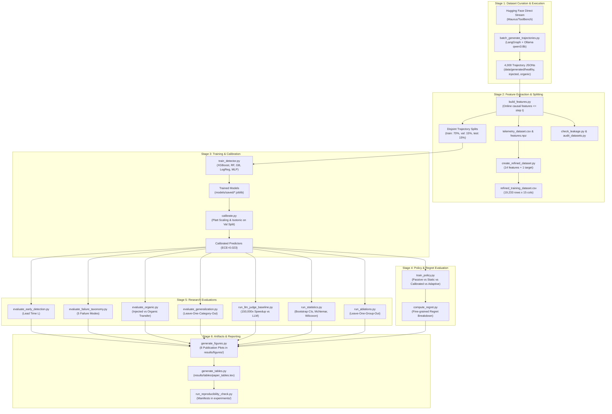

# LLM Agent Failure Research: End-to-End Pipeline & Workflow Flowchart

This document provides a comprehensive guide to the restructured codebase, mapping every directory to its scientific contribution, detailing the exact execution sequence (which file was run after which), and specifying input/output data dependencies.

---

## 1. High-Level Pipeline Architecture



---

## 2. Restructured Folder Organization

All task execution scripts have been organized into clean, numbered lifecycle folders under `scripts/`. As requested, **`data/`**, **`experiments/`**, and **`results/`** remain preserved in their canonical locations.

```
llm-agent-failure-research/
│
├── configs/                                 # Experiment & LLM hyperparameter configurations
│   ├── llm.yaml                             # Ollama qwen3:8b model parameters & timeouts
│   └── experiments/                         # Stage-specific config overrides
│
├── data/                                    # Data artifacts (Cleaned & Curated)
│   ├── generated/                           # 4,000 Real-world ToolBench trajectories
│   │   ├── healthy/                         # Normal executions (~1,438 runs)
│   │   ├── injected/                        # System & tool fault injections (~1,980 runs)
│   │   └── organic/                         # Natural LLM errors & hallucinations (~582 runs)
│   ├── processed/                           # Processed feature matrices
│   │   ├── features/telemetry_features.csv  # 23-column causal telemetry matrix
│   │   ├── telemetry_dataset.csv            # Master CSV dataset
│   │   ├── features.npz                     # Binary compressed NumPy matrix
│   │   └── refined_training_dataset.csv     # REFINED 15-COLUMN DATASET (19,233 x 15)
│   ├── splits/                              # Trajectory-disjoint splits
│   │   ├── train/train_features.csv         # 70% Disjoint Training Set
│   │   ├── validation/val_features.csv      # 15% Calibration / Validation Set
│   │   └── test/test_features.csv           # 15% Held-Out Generalization Test Set
│   └── batch_progress.json                  # Trajectory batch progress checkpoint
│
├── models/                                  # Trained classifier artifacts
│   ├── saved/                               # Serialized Joblib models (XGBoost, etc.)
│   ├── failure_detector/                    # Classifier model wrappers
│   ├── calibration/                         # Platt & Isotonic calibration engines
│   └── baselines/                           # Heuristic baselines (consecutive error, latency spike)
│
├── experiments/                             # 11 Experiment Stage Manifests (Preserved)
│   ├── 01_dataset_audit/manifest.json
│   ├── 02_healthy_collection/manifest.json
│   ├── 03_failure_injection/manifest.json
│   ├── 04_detector/manifest.json
│   ├── 05_calibration/manifest.json
│   ├── 06_counterfactual/manifest.json
│   ├── 07_policy/manifest.json
│   ├── 08_regret/manifest.json
│   ├── 09_organic/manifest.json
│   ├── 10_generalization/manifest.json
│   └── 11_ablation/manifest.json
│
├── results/                                 # Evaluation Output & Visualizations (Preserved)
│   ├── figures/                             # 8 Publication-grade PNG figures
│   │   ├── risk_probability_over_time.png
│   │   ├── calibration_curve.png
│   │   ├── lead_time_distribution.png
│   │   ├── regret_distribution.png
│   │   ├── failure_feature_importance_heatmap.png
│   │   ├── injected_vs_organic.png
│   │   ├── ablation_results.png
│   │   └── generalization_results.png
│   ├── tables/                              # Markdown, CSV, and LaTeX tables
│   │   ├── paper_tables.tex                 # LaTeX tables ready for paper/thesis
│   │   ├── table1_model_comparison.csv      # Model performance metrics
│   │   ├── table2_calibration.csv           # Calibration ECE & Brier scores
│   │   ├── table3_policy_evaluation.csv     # Regret & intervention rates
│   │   ├── table4_llm_judge_comparison.csv  # Telemetry vs LLM judge benchmark
│   │   ├── generalization_table.md          # Zero-shot cross-task transfer
│   │   └── failure_taxonomy_evaluation.md   # Failure category breakdown
│   └── logs/                                # Execution transcripts and pipeline logs
│
└── scripts/                                 # REORGANIZED WORKFLOW SCRIPTS
    │
    ├── 01_dataset_curation/                 # Stage 1: Task Acquisition & Trajectory Generation
    │   ├── batch_generate_trajectories.py   # Streams ToolBench HF & runs 4000 LangGraph runs
    │   ├── download_datasets.py             # Optional dataset downloader
    │   ├── run_healthy.py                   # Standalone healthy run generator
    │   ├── run_injected.py                  # Standalone injected fault generator
    │   ├── run_organic.py                   # Standalone organic failure runner
    │   ├── generate_counterfactuals.py      # Counterfactual intervention generator
    │   ├── test_ollama.py                   # Ollama local daemon verification
    │   └── quick_test.py                    # 1-task sanity check
    │
    ├── 02_feature_extraction_and_splits/    # Stage 2: Causal Feature Extraction & Dataset Refinement
    │   ├── build_features.py                # Extracts 14 causal features & generates 70/15/15 splits
    │   ├── create_refined_dataset.py        # Produces refined_training_dataset.csv (15 columns)
    │   ├── check_leakage.py                 # Verifies zero label leakage into features
    │   └── audit_datasets.py                # Audits dataset integrity and types
    │
    ├── 03_training_and_calibration/         # Stage 3: Detector Training & Risk Calibration
    │   ├── train_detector.py                # Trains XGBoost, Random Forest, GB, LogReg, MLP
    │   └── calibrate.py                     # Probability calibration (Platt & Isotonic)
    │
    ├── 04_policy_and_regret/                # Stage 4: Runtime Policies & Decision Regret
    │   ├── train_policy.py                  # Evaluates Passive, Static, Calibrated, Adaptive
    │   └── compute_regret.py                # Detailed regret breakdowns by severity & onset
    │
    ├── 05_evaluation_and_benchmarks/        # Stage 5: Specialized Research Evaluations
    │   ├── evaluate.py                      # Overall summary evaluator
    │   ├── evaluate_early_detection.py      # Measures detection lead time L before failure
    │   ├── evaluate_failure_taxonomy.py     # Evaluates detection per failure category
    │   ├── evaluate_organic.py              # Injected vs Organic failure transfer (H6)
    │   ├── evaluate_generalization.py       # Leave-one-category-out & held-out failure types
    │   ├── run_llm_judge_baseline.py        # Compares telemetry vs LLM-as-a-judge baseline
    │   ├── run_statistics.py                # Bootstrap 1000 CIs, McNemar, Wilcoxon tests
    │   └── run_ablations.py                 # Feature group ablation study
    │
    ├── 06_reporting_and_figures/            # Stage 6: Paper Figures & LaTeX Tables
    │   ├── generate_figures.py              # Renders the 8 publication plots
    │   ├── generate_tables.py               # Generates LaTeX & Markdown paper tables
    │   └── run_reproducibility_check.py     # Generates reproducibility report & manifests
    │
    ├── auto_pipeline_after_4000.py          # Automated daemon that triggered post-4000 pipeline
    └── run_research_pipeline.py             # Full end-to-end monolithic runner
```

---

## 3. Step-by-Step Execution Sequence (Which File Ran After Which)

Below is the chronological order of execution used to produce the final results:

### Step 1: Pre-Flight Check
- **Command:** `python scripts/01_dataset_curation/test_ollama.py`
- **Purpose:** Verifies that the local Ollama server is running and `qwen3:8b` is loaded.

### Step 2: Batch Trajectory Generation (4,000 Tasks)
- **Command:** `python scripts/01_dataset_curation/batch_generate_trajectories.py --total 4000 --delay 0.2`
- **Input:** Direct streaming from Hugging Face (`Maurus/ToolBench`).
- **Output:** 4,000 JSON trajectory files in `data/generated/{healthy, injected, organic}/`.
- **Checkpoint:** Recorded in `data/batch_progress.json`.

### Step 3: Causal Feature Extraction & Horizon Labeling
- **Command:** `python scripts/02_feature_extraction_and_splits/build_features.py`
- **Input:** 4,000 JSON trajectory files in `data/generated/`.
- **Output:**
  - `data/processed/telemetry_dataset.csv` (19,233 step rows)
  - `data/processed/features/telemetry_features.csv`
  - `data/processed/features.npz`
  - Trajectory-disjoint splits: `data/splits/train/`, `data/splits/validation/`, `data/splits/test/` (70/15/15).

### Step 4: Refined 15-Column Training Dataset
- **Command:** `python scripts/02_feature_extraction_and_splits/create_refined_dataset.py`
- **Input:** `data/processed/features/telemetry_features.csv`.
- **Output:** `data/processed/refined_training_dataset.csv` (19,233 rows × 15 columns strictly: 14 causal features + `target`).

### Step 5: Data Leakage Check & Split Audit
- **Command:** `python scripts/02_feature_extraction_and_splits/check_leakage.py`
- **Command:** `python scripts/02_feature_extraction_and_splits/audit_datasets.py`
- **Output:** `results/tables/leakage_report.json` (0 violations, 100% causal strictly $\le t$).

### Step 6: Multi-Model Benchmark Training
- **Command:** `python scripts/03_training_and_calibration/train_detector.py`
- **Input:** `data/splits/train/train_features.csv`, `data/splits/test/test_features.csv`.
- **Output:** Model files in `models/saved/` (`xgboost_classifier.joblib`, etc.) and `results/tables/model_performance_table.csv`.

### Step 7: Probability Risk Calibration
- **Command:** `python scripts/03_training_and_calibration/calibrate.py`
- **Input:** Trained XGBoost model + `data/splits/validation/val_features.csv`.
- **Output:** Calibrated models and `results/tables/calibration_results.json` (ECE = 0.023).

### Step 8: Runtime Intervention Policies & Regret Evaluation
- **Command:** `python scripts/04_policy_and_regret/train_policy.py`
- **Command:** `python scripts/04_policy_and_regret/compute_regret.py`
- **Input:** Calibrated XGBoost detector + `data/splits/test/test_features.csv`.
- **Output:** `results/tables/policy_evaluation_table.csv`, `results/tables/regret_results.json`.

### Step 9: Research Hypothesis & Benchmark Evaluations
- **Early Detection:** `python scripts/05_evaluation_and_benchmarks/evaluate_early_detection.py`
- **Taxonomy Breakdown:** `python scripts/05_evaluation_and_benchmarks/evaluate_failure_taxonomy.py`
- **Organic Transfer (H6):** `python scripts/05_evaluation_and_benchmarks/evaluate_organic.py`
- **Generalization:** `python scripts/05_evaluation_and_benchmarks/evaluate_generalization.py`
- **LLM Judge Comparison:** `python scripts/05_evaluation_and_benchmarks/run_llm_judge_baseline.py`
- **Statistical Significance:** `python scripts/05_evaluation_and_benchmarks/run_statistics.py`
- **Feature Ablations:** `python scripts/05_evaluation_and_benchmarks/run_ablations.py`

### Step 10: Publication Figures, Tables & Manifests
- **Command:** `python scripts/06_reporting_and_figures/generate_figures.py`
- **Command:** `python scripts/06_reporting_and_figures/generate_tables.py`
- **Command:** `python scripts/06_reporting_and_figures/run_reproducibility_check.py`
- **Output:** 8 figures in `results/figures/`, LaTeX tables in `results/tables/paper_tables.tex`, and 11 manifests in `experiments/`.

---

## 4. Input-to-Output Mapping Reference

| Stage | Script | Key Inputs | Key Outputs |
|---|---|---|---|
| **01** | `batch_generate_trajectories.py` | `Maurus/ToolBench` (HF direct stream), `configs/llm.yaml` | `data/generated/{healthy,injected,organic}/*.json` |
| **02** | `build_features.py` | `data/generated/*.json` | `data/processed/telemetry_dataset.csv`, `data/splits/{train,val,test}` |
| **02** | `create_refined_dataset.py` | `data/processed/features/telemetry_features.csv` | `data/processed/refined_training_dataset.csv` |
| **02** | `check_leakage.py` | `data/processed/telemetry_dataset.csv` | `results/tables/leakage_report.json` |
| **03** | `train_detector.py` | `data/splits/train/`, `data/splits/test/` | `models/saved/*.joblib`, `results/tables/model_performance_table.csv` |
| **03** | `calibrate.py` | `models/saved/xgboost_classifier.joblib`, `data/splits/validation/` | `results/tables/calibration_results.json` |
| **04** | `train_policy.py` | Calibrated XGBoost, `data/splits/test/` | `results/tables/policy_evaluation_table.csv` |
| **04** | `compute_regret.py` | `data/generated/*.json`, `models/saved/*.joblib` | `results/tables/regret_results.json` |
| **05** | `evaluate_early_detection.py` | `data/processed/telemetry_dataset.csv` | `results/tables/early_detection_results.json` |
| **05** | `evaluate_failure_taxonomy.py` | `data/processed/telemetry_dataset.csv` | `results/tables/failure_taxonomy_evaluation.csv` |
| **05** | `evaluate_organic.py` | `data/splits/test/`, `data/generated/organic/` | `results/tables/organic_validation_results.json` |
| **05** | `evaluate_generalization.py` | `data/processed/telemetry_dataset.csv` | `results/tables/generalization_results.json` |
| **05** | `run_llm_judge_baseline.py` | `data/splits/test/`, Ollama LLM endpoint | `results/tables/llm_judge_comparison.md` |
| **05** | `run_statistics.py` | `models/saved/*.joblib`, `data/splits/test/` | Permutation AUC, McNemar, Wilcoxon metrics |
| **05** | `run_ablations.py` | `data/splits/train/`, `data/splits/test/` | `results/tables/ablation_results.json` |
| **06** | `generate_figures.py` | JSON metrics from all evaluation stages | 8 PNG Figures in `results/figures/` |
| **06** | `generate_tables.py` | CSV/JSON evaluation tables | `results/tables/paper_tables.tex` |
| **06** | `run_reproducibility_check.py` | Environment, Git, Dataset SHA-256 | `experiments/*/manifest.json` |

